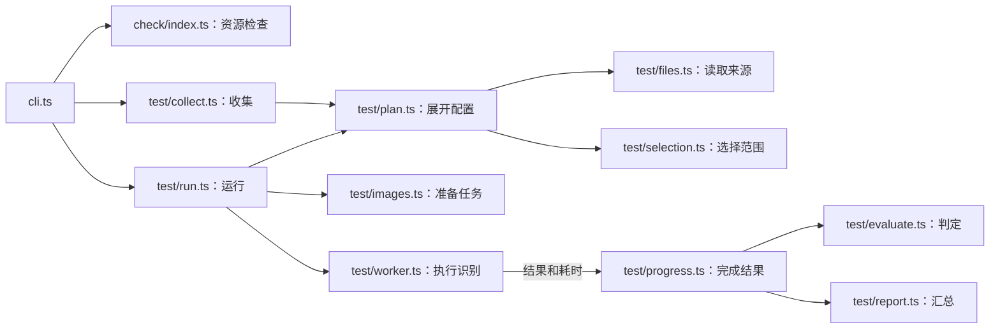

# Maa Tools — 技术架构

> ⚠️ 本文档由 AI 生成，主要用于辅助 AI 理解项目。内容可能与实际代码不同步，请注意甄别。

本包遵循 [通用技术约定](../../extra/common-tech.md)。命令用法和结果字段见 [产品定义](../models/README.md)。

## 模块职责

下表逐一列出包内源码，路径相对 `pkgs/maa-tools/src/`。收集和运行共用文件读取、配置展开与选择规则；识别工作进程和结果判定分别维护。

| 文件                                                               | 用途                                                                                     |
| ------------------------------------------------------------------ | ---------------------------------------------------------------------------------------- |
| [index.ts](../../../pkgs/maa-tools/src/index.ts)                   | 主包公开入口，导出检查、收集、运行、CLI、配置加载、测试文件加载函数及相关类型            |
| [cli.ts](../../../pkgs/maa-tools/src/cli.ts)                       | 加载配置，分派检查、收集和运行，输出文本、JSON 文档或逐行进度，处理命令错误              |
| [cli-args.ts](../../../pkgs/maa-tools/src/cli-args.ts)             | 解析命令、配置路径和过滤参数，提供帮助，拒绝非法下标与参数组合                           |
| [pm.ts](../../../pkgs/maa-tools/src/pm.ts)                         | 提供 `@nekosu/maa-tools/pm` 入口，转导出 pipeline-manager 的接口                         |
| [types/config.ts](../../../pkgs/maa-tools/src/types/config.ts)     | 定义公共配置、检查设置、已展开测试组和单条用例的来源类型                                 |
| [utils/config.ts](../../../pkgs/maa-tools/src/utils/config.ts)     | 用 jiti 加载 TypeScript 配置文件，返回配置对象                                           |
| [utils/paths.ts](../../../pkgs/maa-tools/src/utils/paths.ts)       | 生成来源路径比较键；Windows 忽略大小写，其他系统区分；显示数据由调用方保留原样           |
| [utils/bundle.ts](../../../pkgs/maa-tools/src/utils/bundle.ts)     | 加载 interface bundle，提供单次检查共用的文件内容缓存                                    |
| [utils/maa.ts](../../../pkgs/maa-tools/src/utils/maa.ts)           | 准备框架版本、加载原生模块并设置日志目录；提供图片缓冲区转换和识别用空图片控制器         |
| [check/index.ts](../../../pkgs/maa-tools/src/check/index.ts)       | 组织资源组合检查、控制并发，执行 pipeline 诊断和原生资源加载校验并输出结果               |
| [check/location.ts](../../../pkgs/maa-tools/src/check/location.ts) | 用 `calculateLocation` 把诊断字符偏移转换为行、列位置                                    |
| [test/files.ts](../../../pkgs/maa-tools/src/test/files.ts)         | 读取并校验允许注释的测试 JSON，保留源码范围、注入 origin，记录本次读取的文件             |
| [test/selection.ts](../../../pkgs/maa-tools/src/test/selection.ts) | 构造与合并文件/下标目标，固定完整待检查节点，按平台和来源筛选用例并整理选择元数据        |
| [test/plan.ts](../../../pkgs/maa-tools/src/test/plan.ts)           | 执行 `test.cases` 并校验已展开组，调用选择规则，再从有效 origin 反查实际文件清单         |
| [test/collect.ts](../../../pkgs/maa-tools/src/test/collect.ts)     | 调用同一展开过程，生成收集清单及来源错误，不初始化框架                                   |
| [test/run.ts](../../../pkgs/maa-tools/src/test/run.ts)             | 安排识别任务、计划顺序、并发数与资源分组，管理工作进程和日志；提供详细报告与布尔运行接口 |
| [test/images.ts](../../../pkgs/maa-tools/src/test/images.ts)       | 解析截图路径，把去重截图和完整节点分成识别任务，分摊同图耗时                             |
| [test/worker.ts](../../../pkgs/maa-tools/src/test/worker.ts)       | 在子进程加载指定框架和资源，用截图执行识别，返回原始结果与真实任务耗时                   |
| [test/evaluate.ts](../../../pkgs/maa-tools/src/test/evaluate.ts)   | 按完整节点、预期命中和识别框判定单条用例，构造组结果                                     |
| [test/report.ts](../../../pkgs/maa-tools/src/test/report.ts)       | 按精确来源汇总平台、用例、文件和整批结论，保留缺失结果与未完成验证原因                   |
| [test/progress.ts](../../../pkgs/maa-tools/src/test/progress.ts)   | 等待实际计划中的各平台和节点完成，调用判定与汇总，按序发布开始、完成和范围快照           |
| [test/log-dir.ts](../../../pkgs/maa-tools/src/test/log-dir.ts)     | 分配日志轮次、跟踪活动运行、回收失效标记并清理已结束日志                                 |
| [test/types.ts](../../../pkgs/maa-tools/src/test/types.ts)         | 定义收集清单、识别任务、运行报告和进度事件的结构                                         |
| [test/env.d.ts](../../../pkgs/maa-tools/src/test/env.d.ts)         | 为工作进程需要的框架模块路径、日志目录、资源路径等环境变量提供类型                       |

主包保留 `runCheck`、`runTest`、`runTestDetailed`、`collectTests`、配置与文件加载等公共接口。内部辅助函数按所属用途维护，包入口显式导出公共接口。

主要运行关系如下；命令行先解析参数并加载配置，库调用直接进入对应函数：

收集与运行共用配置展开及来源选择；识别结果返回后由进度模块调用判定和报告。框架版本准备与原生辅助由 [utils/maa.ts](../../../pkgs/maa-tools/src/utils/maa.ts) 提供，工作进程负责每张截图的识别执行。

## 检查流程

1. 加载配置，准备 MaaFramework。
2. 创建发现用 InterfaceBundle，求出控制器与资源组合的有序资源路径。
3. 合并完全相同的有序路径列表。
4. 按 `check.job` 启动有限个任务，每个任务独立创建 bundle 和 Resource。
5. 执行诊断和顺序资源加载，应用严重级别配置。
6. 全部结果就绪后按发现顺序输出，关闭 watcher。

并发调度在同一 Node.js 进程完成，以支持配置中的自定义 parser 函数。每个任务有独立的可变状态；单次检查的只读文件内容由 `CachedContentLoader` 共享缓存。相同路径但顺序不同不能合并，以保留资源覆盖语义。

`runCheck` 只借用 chokidar 的初始扫描生成加载文件集，不是持续监听命令。规划或检查完成后关闭相关 InterfaceBundle watcher，API 调用结束后不应因这些 watcher 挂住。

## 收集与运行共用的定义

[test/files.ts](../../../pkgs/maa-tools/src/test/files.ts) 使用同一套 `parseTestContent`、`readTestFile` 产生运行对象与文件元数据。JSON 允许注释，不允许尾逗号；形状错误转为文件错误条目。成功读取时给每条用例写 `origin: {file: 绝对路径, case: 原始下标}`，组的 `source` 可保留文件路径，但单条身份以 origin 为准。

配置加载和展开期间通过 `AsyncLocalStorage` 保存本次文件读取记录，包括失败文件。CLI 从配置加载前开始记录，因此配置模块顶层提前读取的坏文件也能报告。收集不额外猜测测试目录；配置可以改变扫描目录、glob 或直接提供数组。

`expandTestGroups` 在一次调用中执行配置用例函数、检查展开组结构，再固定 `nodes`。如果配置显式给出节点集合则使用它，否则从过滤前的完整组用例提取。之后才按控制器、资源、来源文件和原始下标过滤，所选组仍保留相同的完整 nodes。

实际进入展开组的 origin 决定清单中的有效文件与原始下标。已读取但被配置主动排除的有效用例不列出；读取失败的文件记录保留。源文件的 controllers/resources 是显示元数据，不能把源声明中的所有控制器和资源组合作为应运行的平台。

无 origin 的程序组可全量运行，但按文件选择明确报错；收集返回 `collection-source-missing` 和已识别文件。组名只用于日志与显示，不作为 map 身份，也不再用截图、期望节点或识别框推断归属。

## 识别执行

1. 展开与选择实际测试，得到 `groups` 和计划文件元数据；零匹配返回 empty。
2. 解析每条用例实际图片路径，记录是否存在，按组内规范化绝对图片路径去重。
3. 使用过滤前固定的 nodes 建任务，按 `maxNodePerJob` 分块。缺图保留 skipped；无待检查节点保留 error，不把零检查当通过。
4. 仅当确有识别任务时准备 MaaFramework 与 bundle，解析有序资源路径；纯缺图或纯无节点不做初始化。
5. 相同有序资源路径的组共用一个进程池，按配置并行任务。不同有序路径组分别创建池。
6. 首次提交某来源相关识别任务时发 case-started；跨平台只开始一次。worker 返回节点识别结果和执行耗时，失败任务留下缺失结果，不能用空数组默认通过。
7. 每张图的全部节点块完成后，立即用 `evaluateCase` 判定该图对应的所有用例，不等整个组或所有计划结束。检查使用同组完整节点：声明的应命中，未声明的不应命中；负例缺少节点结果也算失败。
8. 规范化路径相同的图片只运行一份任务，其时间在对应的所选用例间均分，最后一条取余额。各条用例按自己的期望独立判定，记录到对应实际计划槽位；最后一个计划平台完成后发 case-result，文件全部所选用例完成后发 file-result。
9. 在 finally 中终止池，全部 worker 停止后释放本次日志活动标记。资源规划用 bundle 完成后关闭 watcher。

单条与整文件改变的是待验证截图范围，不是每张截图的断言。名字相同或同图但期望框不同的用例仍分别判定，并各自携带精确 origin。

## 结果与错误

`evaluateCase` 直接返回 `TestCaseRunResult`，不并行维护另一份失败结果数组。`buildTestRunResult` 使用实际结果、文件计划和实际计划组统一构造文件与顶层结果；计划组用于辨别某个平台是否缺结果，不能从源文件声明补造平台。

文件结果保留 `selectedCases`，逐用例条目覆盖这些原始下标。过滤后本次 cases 为空且无文件错误时，文件为 `skipped`、reason 为 `no-cases-selected`，`selectedCases` 和 `cases` 都为空；它不影响其他文件的通过或失败，全部过滤为空时整批仍为 `empty`。有选择却缺结果、坏文件及全缺图无验证仍保留错误。没有用例的文件完成快照使用空计划，与最终文件结论一致。

来源文件路径统一使用 `pathKey`/`samePath` 比较：Windows 规范化后忽略大小写，其他系统保留大小写区分；请求、读取记录、来源筛选、报告和进度均按此匹配与去重，返回路径保留原有大小写。

跨平台用例按 fail、error、skipped、pass 的顺序汇总。文件先看失败和错误，再看各平台是否至少完成过有效检查。部分平台缺图会让用例汇总为 skipped，但另一个平台已验证时文件仍可 pass；不能根据所有聚合用例都 skipped 判定全缺图。

顶层优先报告 error，其次 failed，再是 passed；零匹配为 empty。无来源全量调用按组中真实检查汇总，不因文件列表为空就说没有测试。没有任何有效检查不能返回 passed。

`runTestDetailed` 返回这一完整结果。`runTest` 使用同一结果计算布尔值，并在 failed/error 时把完整 `TestRunResult` 写到指定错误文件；它不再维护用于文本推断的旧结果数组。

组/用例的时间是实际识别任务时间及其分摊，顶层时间是本次运行实际经过的时间，包含准备、等待和清理；并行任务求和可能大于后者。

## 命令行机器输出

`--list` 选择收集操作，`--json` 选择 JSON 格式，二者可组合：单独 `--list` 输出人类列表，`--list --json` 输出同一完整收集清单。默认运行输出文本，`--json` 输出一份运行报告，`--jsonl` 每行输出进度并以唯一 `run-result` 结束。拒绝 `--json --jsonl`、`--list --jsonl` 和 `--list --case`。

所有收集及 JSON 输出从配置加载前把 JavaScript 日志转到 stderr；收集列表、JSON 文档和流式记录使用保存的 stdout 出口。这个接管不拦截原生代码直接写文件描述符；识别进程另关闭原生 stdout 日志。

选择 `--json` 或 `--jsonl` 后，参数、配置、测试文件、来源与运行错误都用相应机器格式输出。单独 `--list` 的错误只作文字说明，不混入 JSON；`--list --json` 保留完整错误 JSON。成功收集清单含 `schemaVersion` 和 `files`，顶层错误另带 `errorCode`、`reason` 等字段；两种列表都从同一 `collectTests` 结果格式化，不初始化 MaaFramework。运行报告仍使用完整 `TestRunResult`。

配置 `mode: 'json'` 控制内部日志输出，完整报告或逐行进度由 CLI 显式 `--json`、`--jsonl` 选择。`--version` 不加载配置并输出普通版本字符串。

## 即时事件与最终报告

`TestRunOptions.onEvent` 接收从测试入口导出的 `TestRunEvent`。事件形状见 [即时开始与完成](../models/README.md#即时开始与完成)。`TestRunProgress` 按配置实际展开的组与用例槽位统计每个 origin 的待完成数，不用源声明的平台组合推断，也不用组名作身份。

每张图的节点块都结束后，执行层给复用该图的各条用例独立判定并分摊时间。每记录一个实际槽位就减少来源的待完成数；归零才发布该来源的完成快照，文件的所选来源全完成才发布文件快照。缺图、无节点、坏文件和已知范围的无匹配条目直接产生确定结果，不发虚假的识别开始。

快照只包含对应文件与原始下标，groups 也按该范围裁剪并重算组结论与时间。快照和最终报告均调用同一 `buildTestRunResult`；已完成槽位只写一次。异常收尾为未完成槽位补明确 error，不覆盖先前已完成的检查结果。

事件队列串行等待 `onEvent`，识别任务仍按原计划并行。传给回调的是独立快照；回调抛错或拒绝时记录一次错误、停发后续事件，正式识别与最终结果继续。调用方不能依赖每个事件都必达，最终报告负责补全与核对。

CLI 在 `--jsonl` 下把 `onEvent` 的三类进度依次写为标准输出行，最终再写唯一 `{schemaVersion: 1, type: 'run-result', result}`。`run-result` 由 CLI 写出，不属于框架的三类 `TestRunEvent`；参数或配置错误同样使用这个结束记录，包括原始参数含 `--jsonl` 的非法组合。

每行使用保存的 stdout 写入函数序列化，并等待标准流写入回调；日志走 stderr。扩展所有运行固定使用 `--jsonl`，子进程忽略标准输入，只使用标准输出和错误输出的管道。逐行解析处理分块、中文字符、Windows 换行（CRLF）、多行同块和大行，不能把一次 data 回调当成一条 JSON。

接收方拒绝未知记录、重复 `run-result`、其后又有记录或完整畸形行；正常结束缺少最后报告或留下截断行也报错。用户取消或信号终止时，只忽略末尾尚未完成的行，保留此前校验的完成事实；已经收到的完整错误记录仍优先报协议错误。取消由父进程终止子进程，面板跳过未完成项，不编造整批通过。

## MaaFramework 日志目录

`loadMaa(modulePath, logDir)` 设置 `maa.Global.log_dir`。`setupMaa` 在构造版本管理器时传入 `maaCache`、`maaMirror`，版本查询和安装使用配置的来源。

- check 默认写 `<cwd>/debug`，`maaLogDir` 可覆盖，避免把框架日志清理指向仓库根。
- test 每轮在日志根创建 `maa-tools-run-<n>`；活动轮次有所属进程标记，worker 再用 pool/pid 子目录隔离。
- `test.maaLogKeep` 默认 10，表示保留的已结束轮次数。正在运行的目录全部保留，不占这 10 个名额；并发运行不能删别人的活动日志。
- worker 全部退出后释放标记，进程正常 exit 也会清理本进程标记。被终止或崩溃遗留的标记在下次创建轮次时按进程存活状态回收。

## 构建与验证入口

下表路径相对包目录 `pkgs/maa-tools/`：

| 文件                                                           | 用途                                                                           |
| -------------------------------------------------------------- | ------------------------------------------------------------------------------ |
| [package.json](../../../pkgs/maa-tools/package.json)           | 定义命令入口、主包和 `pm` 子入口、依赖；`lint` 做类型检查，`test` 运行源码测试 |
| [bin/maa-tools](../../../pkgs/maa-tools/bin/maa-tools)         | 可执行命令入口，调用构建后主包的 `runCliFromArgs`，设置退出码并等待标准流排空  |
| [tsdown.config.mts](../../../pkgs/maa-tools/tsdown.config.mts) | 构建主包、`pm` 和识别工作进程三个入口，生成模块、类型声明和源码映射            |
| [tsconfig.json](../../../pkgs/maa-tools/tsconfig.json)         | 配置模块解析、MaaFramework/Node 类型及源码和测试的检查范围                     |

测试文件按功能组织：

| 文件（相对包目录）                                                           | 验证内容                                                        |
| ---------------------------------------------------------------------------- | --------------------------------------------------------------- |
| [test/cli-args.test.ts](../../../pkgs/maa-tools/test/cli-args.test.ts)       | 参数顺序、重复选项、原始下标和不支持的参数组合                  |
| [test/cli.test.ts](../../../pkgs/maa-tools/test/cli.test.ts)                 | 配置加载、文本列表与 JSON 清单、命令错误、退出码和日志输出位置  |
| [test/cli-stream.test.ts](../../../pkgs/maa-tools/test/cli-stream.test.ts)   | 逐行进度、唯一最终报告、错误结束记录和包含中文的大行            |
| [test/files.test.ts](../../../pkgs/maa-tools/test/files.test.ts)             | 注释 JSON 的解析与校验、名称和节点归一、原始下标与源码范围      |
| [test/selection.test.ts](../../../pkgs/maa-tools/test/selection.test.ts)     | 文件及用例范围、目标合并、错误下标、完整负例节点和来源身份      |
| [test/collect.test.ts](../../../pkgs/maa-tools/test/collect.test.ts)         | 实际配置决定收集范围，保留坏文件、loader 来源和明确收集错误     |
| [test/evaluate.test.ts](../../../pkgs/maa-tools/test/evaluate.test.ts)       | 命中、负例、识别框、缺结果、同图任务与耗时分摊的判定            |
| [test/report.test.ts](../../../pkgs/maa-tools/test/report.test.ts)           | 跨平台与文件汇总、计划覆盖、空选择、坏文件和重复目标            |
| [test/progress.test.ts](../../../pkgs/maa-tools/test/progress.test.ts)       | 图片与平台完成顺序、范围快照、回调异常及与最终报告一致          |
| [test/run.test.ts](../../../pkgs/maa-tools/test/run.test.ts)                 | 计划排序、默认并发数及有序资源路径分组                          |
| [test/early-error.test.ts](../../../pkgs/maa-tools/test/early-error.test.ts) | 初始化前的错误仍完整保留重复目标的选择和完成事实                |
| [test/log-dir.test.ts](../../../pkgs/maa-tools/test/log-dir.test.ts)         | 日志轮次编号、保留数量、并发活动保护及异常遗留标记回收          |
| [test/path-key.test.ts](../../../pkgs/maa-tools/test/path-key.test.ts)       | Windows 路径大小写匹配、非 Windows 区分大小写以及各阶段来源对齐 |

## 依赖与测试边界

| 依赖                           | 作用                                 |
| ------------------------------ | ------------------------------------ |
| `@nekosu/maa-locale`           | 输出语言                             |
| `@nekosu/maa-pipeline-manager` | Pipeline 及 interface 资源加载与诊断 |
| `@nekosu/maa-version-manager`  | MaaFramework 版本准备                |
| `jiti`                         | 加载 TypeScript 配置                 |
| `jsonc-parser`                 | 带注释测试文件的解析与字符范围       |
| `workerpool`                   | 隔离识别进程并行任务                 |
| `@actions/core`、`chalk`       | 工作流注解与终端输出                 |

来源、选择和汇总测试应覆盖重复组名、同图不同框、loader 改目录/排除条目、部分平台缺图和缺失结果；执行测试覆盖完整节点负例、任务去重和耗时求和。即时事件测试覆盖节点块乱序完成、跨平台最后一个才结束、直接完成项、回调失败和最终一致性。CLI 测试覆盖配置日志、错误结束记录、参数冲突、大行完整输出及单报告模式；扩展测试覆盖中文/CRLF/分块、多行、未知或重复记录、最后报告遗漏/截断、取消残片与最终校验。日志测试覆盖并发活动目录，编辑器不复制框架判定规则。
